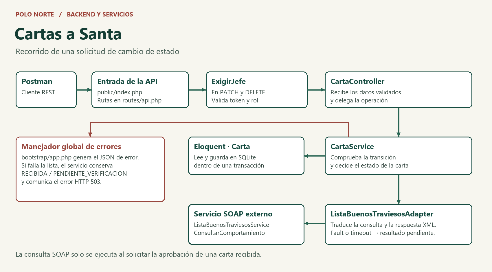

# Cartas a Santa y gestión de regalos

API REST del escenario A. Laravel, Composer y SQLite. Todas las operaciones se pueden demostrar desde Postman. El simulador incluido habla SOAP 1.1 y se ejecuta en un proceso independiente.

## Ejecutar en Visual Studio Code

Abre la carpeta que contiene `artisan` y `composer.json`. Usa PHP 8.5 con PDO SQLite, DOM, cURL y mbstring, y Composer 2. En **Terminal → Nueva terminal**, ejecuta estos comandos desde la raíz.

```powershell
composer install
php scripts/preparar.php
php artisan migrate
php -S 127.0.0.1:8081 mock/lista.php
```

Deja esa terminal abierta. En una **segunda terminal**, inicia Laravel.

```powershell
php artisan serve --host=127.0.0.1 --port=8000
```

Abre http://127.0.0.1:8000/api/cartas. Una base nueva devuelve `[]`. Para detener cada servidor, pulsa Ctrl+C en su terminal. En sesiones posteriores basta con iniciar ambos servidores.

## Configuración y credenciales locales

El preparador crea `.env` desde `.env.example`, genera claves aleatorias y crea `database/database.sqlite`. Puedes repetirlo conservando las claves y las cartas.

| Variable | Uso |
| --- | --- |
| APP_KEY | Clave interna de Laravel generada localmente. |
| DB_CONNECTION | Por defecto, sqlite. |
| TOKEN_ELFO_JEFE | API key del jefe de taller. Autoriza PATCH y DELETE. |
| TOKEN_ELFO | API key del elfo. Permite demostrar el 403. |
| LISTA_SOAP_URL | Endpoint HTTP POST de la lista. Por defecto, http://127.0.0.1:8081. |

Para usar el servicio del docente, copia su URL de operaciones en `LISTA_SOAP_URL`, ejecuta `php artisan config:clear` y reinicia la API. El adaptador envía el sobre XML directamente. Los tokens se envían como `Authorization: Bearer <token>`.

## Probar en Postman

Importa [la colección del escenario A](postman/Cartas-a-Santa.postman_collection.json). En las variables de la colección, copia desde tu archivo local `.env` el valor de `TOKEN_ELFO_JEFE` en `tokenJefe` y el de `TOKEN_ELFO` en `tokenElfo`. Guarda los valores localmente. Ejecuta **Run collection** en el orden incluido. La creación guarda el identificador para las siguientes peticiones. Usa el simulador incluido para reproducir exactamente los ejemplos.

| Método y recurso | Acceso | Resultado |
| --- | --- | --- |
| POST /api/cartas | Público | 201 y cabecera Location |
| GET /api/cartas | Público | 200. Filtros combinables por estado y ciudad, nombre abreviado y edad oculta |
| GET /api/cartas/{id} | Público | 200 y detalle completo |
| PUT /api/cartas/{id} | Público | 200 al reemplazar los cuatro campos editables de una carta RECIBIDA |
| PATCH /api/cartas/{id}/estado | ELFO_JEFE | 200 con el estado efectivo |
| DELETE /api/cartas/{id} | ELFO_JEFE | 204, salvo si ya está ENTREGADA |

Ejemplo de cuerpo para crear o editar una carta:

```json
{"remitente":"Valentina Pérez","edad":9,"ciudad":"Guayaquil","regalos":["Libro","Tren"]}
```

Para aprobar, envía `{"estado":"APROBADA"}`. El simulador devuelve BUENO para Valentina, TRAVIESO para el remitente exacto `Travieso` y un SOAP Fault para `Grinch`. También puedes detener el simulador y reintentar una aprobación. Con la lista caída, consulta después la misma carta para ver RECIBIDA y PENDIENTE_VERIFICACION.

La colección cubre el flujo hasta ENTREGADA y los errores 400 (JSON inválido), 401 (sin token), 403 (rol ELFO), 404 (ID inexistente), 409 (transición prohibida), 422 (regalos duplicados) y 503 (SOAP Fault). Cada ejecución crea cartas de demostración. Del 25 al 31 de diciembre el registro devuelve 422 por la regla de cierre anual en America/Guayaquil. Las pruebas automatizadas fijan el reloj para verificar el último segundo del 24 y el primero del 25.

```powershell
php artisan test
php artisan route:list --path=api
```

## Arquitectura



1. Postman envía JSON. Laravel selecciona la ruta en `routes/api.php`. El middleware `ExigirJefe` comprueba el token en las dos rutas protegidas.
2. Las solicitudes de `app/Http/Requests` validan la entrada. `CartaController` delega en `CartaService` y construye la respuesta HTTP.
3. `CartaService` controla fechas, transiciones y permisos de edición según el estado. El modelo Eloquent `Carta` guarda los cambios en SQLite. La transacción evita que dos peticiones modifiquen simultáneamente el mismo estado.
4. Al aprobar, `ListaBuenosTraviesosAdapter` consulta el servicio externo. Hace hasta dos intentos con una pausa de 100 ms y un presupuesto total de tres segundos. BUENO aprueba la carta y TRAVIESO la rechaza. Tras Fault, desconexión o respuesta ilegible, el servicio conserva la carta pendiente y termina la transacción antes de lanzar el error 503.
5. El manejador en `bootstrap/app.php` devuelve `codigo`, `mensaje`, `detalles`, `timestamp` y `ruta` para los errores de la API.

## Si el Polo Norte adoptara microservicios

Cartas sería dueño del remitente, la ciudad, los regalos solicitados y el historial de recepción y aprobación. Comportamiento administraría la lista y sus verificaciones. Taller gestionaría las órdenes de producción y Entregas custodiaría los despachos y sus confirmaciones. Cada servicio tendría su propia base y comunicaría sus cambios mediante eventos identificados para evitar duplicados. Si Comportamiento cae el 24 a las 23:00, Cartas seguiría recibiendo y mostrando solicitudes. Una aprobación devolvería 503 y conservaría la carta recibida con verificación pendiente. Al restablecerse la lista, se podría reintentar sin crear otra carta ni enviar dos órdenes de producción.

## Sustentación y entrega

| Tiempo | Qué mostrar en tu pantalla y explicar con tu voz |
| --- | --- |
| 0:00–1:45 | Abre el diagrama. Sigue las flechas desde Postman y explica qué componente decide si una carta se aprueba. |
| 1:45–3:15 | Sigue PATCH desde routes/api.php hasta ExigirJefe, CartaController, CartaService y el modelo. Enseña cómo TRAVIESO termina en RECHAZADA. |
| 3:15–4:25 | Ejecuta en Postman las tres peticiones de Grinch. Muestra el 503 y el GET posterior. Explica por qué la carta puede reintentarse. |
| 4:25–4:55 | Explica con tus palabras qué aprendiste y una mejora que aplicarías, por ejemplo registrar los reintentos para seguimiento. |

Para Moodle, adjunta la colección sin secretos y los enlaces a tu repositorio y a tu video de hasta cinco minutos con acceso para el docente. Comentario de entrega sugerido: **Escenario A · Cartas a Santa y gestión de regalos**.
